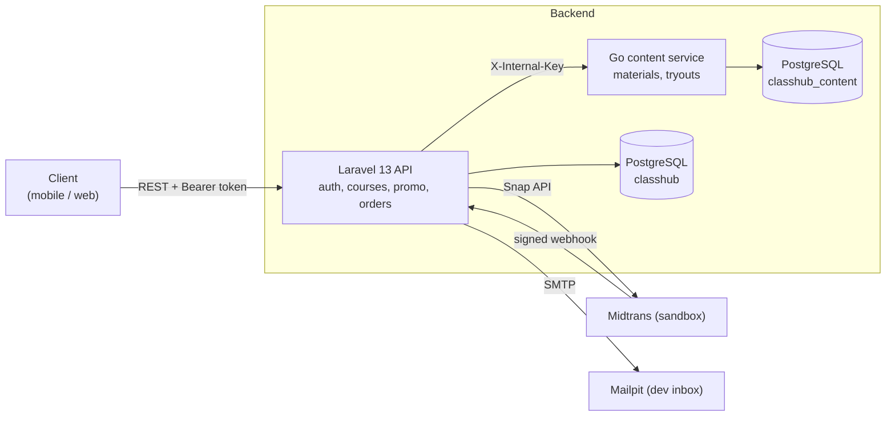
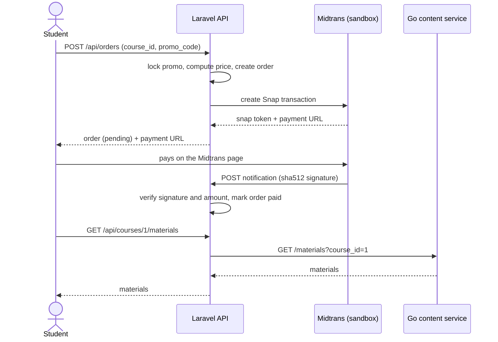
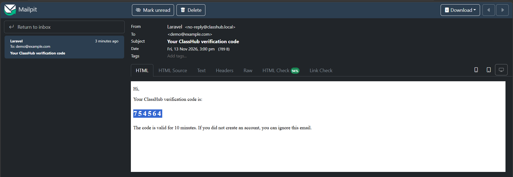
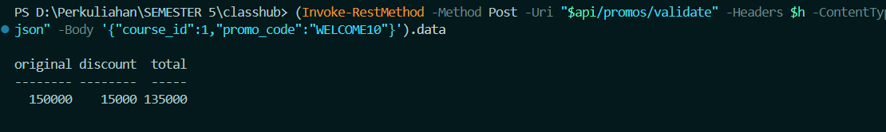
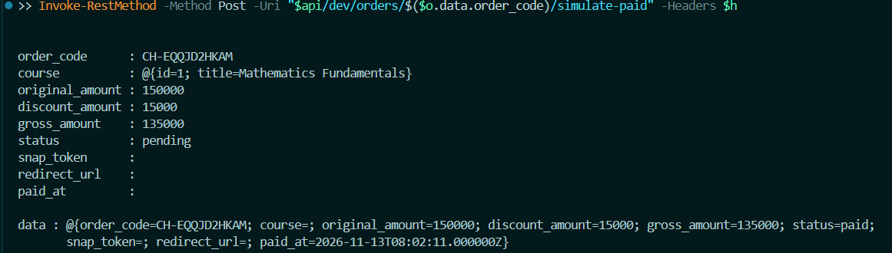
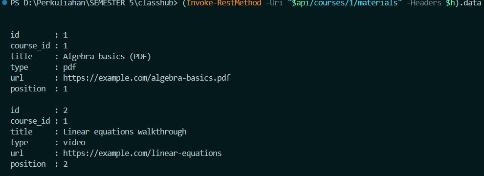
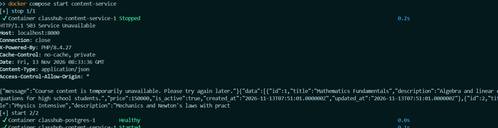

# ClassHub

[](https://github.com/Stevens2606/classhub/actions/workflows/ci.yml)


Backend of an online class platform. Students register with an **email OTP**, buy courses with a **promo code** through the **Midtrans** payment gateway (sandbox), and read course content that is served by a separate **Go microservice**.

I built it as a portfolio project to practice the backend skills I used in my team projects at Institut Teknologi Del (a tutoring app with Laravel, Go, and PostgreSQL). It is a new codebase, written from scratch and published under my own account.

## Architecture



The API and the content service are separate programs with **separate databases**. If the content service goes down, only the content endpoints return `503`. Login, browsing courses, and payments keep working.

### Buying a course



## Features

| Area | What it does |
| --- | --- |
| Authentication | Register, email OTP verification, login, logout with Laravel Sanctum tokens |
| OTP safety | 6 digits, valid 10 minutes, stored only as a hash, max 5 wrong attempts, rate limited |
| Courses | Public course list; content only for students who paid |
| Promo codes | Percent or fixed discount, usage limit, expiry date, checked under a database lock |
| Payments | Midtrans Snap (sandbox), webhook with signature and amount check, idempotent handling |
| Microservice | Go service with its own database, protected by an internal key, graceful shutdown |
| Resilience | Content service outage only affects content endpoints |

## Demo

Screenshots from a local run with Docker Compose.

**1. Email OTP** (caught by Mailpit)



**2. Price preview with a promo code** (`WELCOME10`: 150,000 becomes 135,000)



**3. Order created, then payment confirmed** (local `simulate-paid` endpoint)



**4. Course content served by the Go microservice**



**5. Resilience: content service stopped.** Only the content endpoint returns `503`; the course list still works.



## Tech stack

- **Laravel 13** (PHP 8.4), Laravel Sanctum, Laravel Mail
- **Go 1.24**, standard library `net/http`, `database/sql` with `lib/pq`
- **PostgreSQL 16**, one database per service
- **Docker Compose**, Mailpit for reading OTP emails locally
- **GitHub Actions** for Go tests and PHP syntax checks

## Run it locally

You need Docker and Docker Compose.

```bash
git clone https://github.com/Stevens2606/classhub.git
cd classhub
docker compose up --build
```

The first start downloads Laravel and takes a few minutes. When you see `API ready on http://localhost:8000`, the API is running.

| Service | URL |
| --- | --- |
| API | http://localhost:8000/api |
| Mailpit (OTP emails) | http://localhost:8025 |

Optional: copy `.env.example` to `.env` and add a [Midtrans sandbox](https://dashboard.sandbox.midtrans.com) server key to enable real Snap payment pages. Without a key everything else works, and you can use the local-only `simulate-paid` endpoint shown below.

## Try it

```bash
API=http://localhost:8000/api

# 1. Register, then open http://localhost:8025 and copy the 6-digit code
curl -s -X POST $API/auth/register -H 'Content-Type: application/json' \
  -d '{"name":"Demo Student","email":"demo@example.com","password":"password123"}'

# 2. Verify the code to get a token
TOKEN=$(curl -s -X POST $API/auth/verify-otp -H 'Content-Type: application/json' \
  -d '{"email":"demo@example.com","otp":"123456"}' | python3 -c 'import sys,json; print(json.load(sys.stdin)["token"])')

# 3. See the price with a promo code
curl -s -X POST $API/promos/validate -H "Authorization: Bearer $TOKEN" -H 'Content-Type: application/json' \
  -d '{"course_id":1,"promo_code":"WELCOME10"}'

# 4. Create an order
curl -s -X POST $API/orders -H "Authorization: Bearer $TOKEN" -H 'Content-Type: application/json' \
  -d '{"course_id":1,"promo_code":"WELCOME10"}'

# 5. Local only: pretend the payment succeeded (use the order_code from step 4)
curl -s -X POST $API/dev/orders/CH-XXXXXXXXXX/simulate-paid -H "Authorization: Bearer $TOKEN"

# 6. Read the course content (served by the Go service)
curl -s $API/courses/1/materials -H "Authorization: Bearer $TOKEN"
```

Demo promo codes: `WELCOME10` (10% off) and `HEMAT25K` (Rp 25.000 off).

### See the resilience in action

```bash
docker compose stop content-service
curl -i $API/courses/1/materials -H "Authorization: Bearer $TOKEN"   # 503, content only
curl -s $API/courses                                                  # still works
docker compose start content-service
```

## API overview

| Method | Endpoint | Auth | Description |
| --- | --- | --- | --- |
| POST | `/api/auth/register` | - | Create an account and email an OTP |
| POST | `/api/auth/verify-otp` | - | Verify the code, returns a token |
| POST | `/api/auth/resend-otp` | - | Send a new code |
| POST | `/api/auth/login` | - | Login (verified accounts only) |
| POST | `/api/auth/logout` | Token | Revoke the current token |
| GET | `/api/auth/me` | Token | Current user |
| GET | `/api/courses` | - | List courses |
| GET | `/api/courses/{id}` | - | Course detail |
| GET | `/api/courses/{id}/materials` | Token, paid | Materials (Go service) |
| GET | `/api/courses/{id}/tryouts` | Token, paid | Tryouts (Go service) |
| POST | `/api/promos/validate` | Token | Price preview with a promo code |
| POST | `/api/orders` | Token | Create an order, returns the Midtrans payment URL |
| GET | `/api/orders` | Token | My orders |
| GET | `/api/orders/{order_code}` | Token | One order |
| POST | `/api/payments/midtrans/notification` | Signature | Midtrans webhook |

Content service (internal, needs the `X-Internal-Key` header): `GET/POST /materials`, `GET/POST /tryouts`, `GET /healthz`.

## Design decisions

- **Separate content service.** Content can be developed, deployed, and fail without touching accounts or payments. Each service owns its database, so they never share tables.
- **OTP stored as a hash.** A leaked database does not reveal valid codes. Attempts are limited and codes expire.
- **Webhook verification.** Every Midtrans notification is checked with its SHA-512 signature and the amount. A paid order is never changed again if Midtrans retries.
- **Transaction around checkout.** Order creation, promo usage, and the gateway call succeed or roll back together. The promo row is locked so the last slot cannot be used twice.
- **Sandbox only.** Midtrans runs in sandbox mode. No real money is moved.

## Project structure

```
classhub/
├── api-laravel/
│   ├── Dockerfile
│   ├── docker-entrypoint.sh      # creates the Laravel skeleton on first run
│   └── overlay/                  # the application code
│       ├── app/Http/Controllers/ # Auth, Course, Order, Promo, PaymentWebhook
│       ├── app/Services/         # Midtrans, content client, pricing
│       ├── app/Models/
│       ├── database/             # migrations and seeder
│       └── routes/api.php
├── content-service/              # Go microservice
│   ├── cmd/server/main.go
│   └── internal/
│       ├── api/                  # handlers and tests
│       └── pgstore/              # PostgreSQL store
├── docker/postgres-init.sql
├── docker-compose.yml
└── .github/workflows/ci.yml
```

## Tests

```bash
cd content-service
go mod tidy
go test ./...
```

The Go service has unit tests for authentication, validation, and the list and create endpoints, using an in-memory store.

## Roadmap

- Feature tests for the Laravel API
- Admin endpoints to manage courses, promos, and content
- OpenAPI documentation
- Practice questions as a third microservice

## Author

**Steven Simanjuntak**, D3 Information Technology student at Institut Teknologi Del.
[LinkedIn](https://www.linkedin.com/in/steven-simanjuntak-0b09a2418/) · [GitHub](https://github.com/Stevens2606)

## License

MIT
